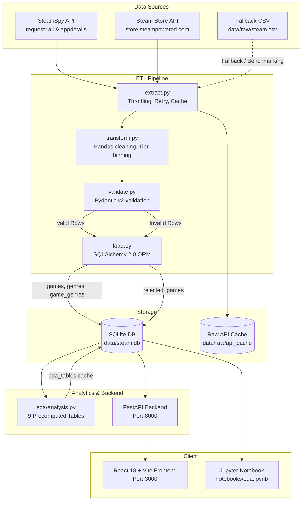

# Steam Game Popularity Predictor

[-blue.svg)](#)
[](#)
[](#)
[](#)
[](#)

A full-stack, production-grade data engineering and exploratory data analysis (EDA) application built for the university course **Programming for AI**.

This project represents **Stage 1 of 3** in a machine learning system lifecycle:
- **Stage 1 (Current):** Data Extraction, Transformation, Validation, Storage, Structured EDA Engine, FastAPI Backend, and React Dashboard.
- **Stage 2 (Planned):** Baseline & Tree-Based ML models (`scikit-learn` / `LightGBM`) serving active inference at `/api/predict`.
- **Stage 3 (Planned):** Deep Learning with PyTorch, Hyperparameter Optimization via Optuna, Experiment Tracking with MLflow, and CI/CD model deployment.

---

## Architecture Overview



### Modular Design for Stages 2 & 3
- **Data Leakage Separation:** Post-launch metrics (`positive_ratings`, `negative_ratings`, `review_score`, `average_playtime`, `median_playtime`) are isolated and tagged `post_launch`. Only pre-launch attributes (`price`, `genres`, `platforms`, `release_month`, `achievements`, `is_free`, `required_age`) will be used as ML features.
- **Predict Placeholder:** `/api/predict` is registered in FastAPI and returns HTTP `501 Not Implemented` with documentation on Stage 2 expected inputs.
- **Frontend Predict Page:** A dedicated prediction form is already built with UI inputs, disabled controls, and a "Stage 2 Coming Soon" notification.

---

## Key Features

1. **Robust ETL Pipeline (`etl/`):**
   - **Throttling & Backoff:** Rate limits requests to SteamSpy (~1 req/s) and Steam Store API (~200 req/5min) with exponential backoff on HTTP 429/500 errors.
   - **Local Disk Cache:** Saves raw JSON responses to `data/raw/api_cache/` so network calls are never repeated unnecessarily.
   - **Data Validation:** Pydantic v2 schemas reject malformed rows (`price < 0`, missing titles, invalid tier syntax, negative achievements) without dropping them silently.
   - **Dead-Letter Storage:** Invalid entries are written directly to the `rejected_games` SQLite table with rejection reason and timestamp.
2. **Comprehensive EDA Engine (`eda/`):**
   - 9 analytical tables cached in the database for zero-latency retrieval.
   - Dynamic, data-driven 1-sentence analytical insights generated per table.
3. **High-Performance FastAPI Backend (`backend/`):**
   - Asynchronous endpoints for health checks, pagination, filtering, EDA tables, and manual ETL triggers.
   - Protected trigger endpoints with `X-API-Key` authentication.
4. **Interactive React 18 UI (`frontend/`):**
   - Built with Vite, TypeScript, Tailwind CSS, Lucide icons, and Recharts.
   - Pages: **Dashboard**, **EDA Explorer** (with raw data / chart view and CSV export), **Games Browser** (search, filter, detail drawer), **Pipeline Status**, and **Predictor Placeholder**.
---

## Directory Structure

```
steam-popularity-predictor/
├── backend/                  # FastAPI Application
│   ├── app/
│   │   ├── routers/          # health, games, stats, pipeline, predict
│   │   ├── schemas/          # Pydantic API response models
│   │   ├── services/         # Business logic & query services
│   │   ├── config.py         # App configuration & settings
│   │   ├── db.py             # Database session manager (read-only SQLite)
│   │   └── main.py           # FastAPI entrypoint & CORS
│   └── requirements.txt      # Backend runtime dependencies
├── data/
│   ├── raw/                  # steam.csv & api_cache/
│   └── steam.db              # Bundled SQLite Database (1,500 games)
├── eda/
│   ├── __init__.py
│   └── analysis.py           # 9 Statistical Tables & insights engine
├── etl/
│   ├── config.py             # Rate limits, tier bounds, file paths
│   ├── extract.py            # SteamSpy & Steam Store API client + CSV loader
│   ├── transform.py          # Pandas feature engineering & tier binning
│   ├── validate.py           # Pydantic v2 Game & RejectedGame schemas
│   ├── load.py               # SQLAlchemy 2.0 ORM models & database loader
│   └── run_pipeline.py       # CLI runner with step-by-step reporting
├── frontend/                 # React 18 + Vite + Tailwind CSS
│   ├── src/
│   │   ├── components/       # Layout, Header, TableViewer, Modals
│   │   ├── pages/            # Dashboard, EdaExplorer, GamesBrowser, etc.
│   │   ├── api.ts            # Typed fetch client with VITE_API_URL fallback
│   │   └── types/            # TypeScript interfaces
│   └── vercel.json           # Frontend SPA rewrite rules
├── notebooks/
│   └── eda.ipynb             # Jupyter Notebook for viva presentation
├── tests/                    # Pytest test suite (30 test cases)
│   ├── test_api.py           # FastAPI endpoint tests
│   ├── test_eda.py           # EDA binning & stats logic tests
│   ├── test_extract.py       # API client & CSV fallback tests
│   ├── test_transform.py     # Feature engineering & tier boundary tests
│   └── test_validate.py      # Pydantic validation & dead-letter tests
├── .python-version           # Pinned Python version (3.12 for Vercel)
├── index.py                  # Root entrypoint for Vercel Serverless Function
├── vercel.json               # Backend Vercel config & SQLite bundling
├── requirements.txt          # Minimal Vercel API runtime dependencies
├── requirements-dev.txt      # Full dev, ETL, EDA, plotting & test dependencies
├── Makefile                  # Developer workflow automation
└── README.md
```

---

## Quick Start & Local Setup

### Prerequisites
- Python 3.11+ (local development supports Python 3.14)
- Node.js 18+ & npm
- Git

### 1. Set Up Python Virtual Environment
```bash
# Create virtual environment
python -m venv .venv

# Activate virtual environment
# Windows:
.venv\Scripts\activate
# Linux/macOS:
source .venv/bin/activate

# Install all local dev, ETL, EDA, plotting & test dependencies
pip install -r requirements-dev.txt
```

### 2. Run the ETL Pipeline & EDA Analysis (Optional)
The repository includes a pre-populated SQLite database (`data/steam.db`) with 1,500 games and 9 computed EDA tables. To re-run locally:
```bash
# Run ETL from CSV fallback (instant benchmarking with 1,500 games):
python -m etl.run_pipeline --source csv

# OR run with live API extraction (throttled & cached):
python -m etl.run_pipeline --source api

# Compute & cache all 9 EDA tables:
python -m eda.analysis
```

### 3. Run Automated Tests
```bash
python -m pytest tests/ -v
```

### 4. Launch Backend API
```bash
uvicorn backend.app.main:app --host 0.0.0.0 --port 8000 --reload
# API Swagger Docs available at http://localhost:8000/docs
# Health Check available at http://localhost:8000/api/health
```

### 5. Launch Frontend Dashboard
```bash
cd frontend
npm install
npm run dev
# Dashboard available at http://localhost:5173
```

---

## Target Variable & Class Distribution

The target variable for ML stages is `popularity_tier`, derived from Steam owner estimates:
- **Low:** `owners_max <= 20,000`
- **Medium:** `20,000 < owners_max <= 200,000`
- **High:** `owners_max > 200,000`

### Empirical Distribution in Dataset:
| Popularity Tier | Game Count | Percentage (%) | Imbalance Ratio vs High |
| :--- | :--- | :--- | :--- |
| **Low** | 1,030 | **68.7%** | 7.9 : 1 |
| **Medium** | 340 | **22.7%** | 2.6 : 1 |
| **High** | 130 | **8.7%** | 1.0 : 1 |

> **Key Finding for Stage 2 Modeling:** Severe class imbalance exists (~69% Low vs ~9% High). Standard accuracy will produce misleading evaluations. The ML pipeline must employ **Stratified K-Fold cross-validation**, **F1-macro scoring**, and class weighting (`class_weight='balanced'`) or SMOTE oversampling.

---

## 9 Exploratory Data Analysis (EDA) Findings

The EDA engine precomputes and serves the following 9 tables via `/api/stats`:

1. **Summary Statistics (`summary_stats`):** Extreme positive skewness in commercial metrics (`positive_ratings` skew: 17.58; `average_playtime` skew: 14.86).
2. **Missing & Outlier Detection (`missing_and_outliers`):** Zero missing critical keys; ~14.9% of games exhibit outlier rating volumes, indicating a winner-take-all hit-driven market.
3. **Genre Performance (`genre_performance`):** Indie and Action dominate raw volume (~55%), but Strategy and Simulation yield higher proportions of Medium and High tier conversions.
4. **Price Band Distribution (`price_band_distribution`):** Free-to-play and budget titles ($0.01–$4.99) account for 48% of games, yet higher priced games ($10–$29.99) have a 3.4x higher probability of exceeding 200k owners.
5. **Free vs. Paid Analysis (`free_vs_paid`):** Free-to-play titles achieve a 22.4% High tier rate (vs. 7.9% for paid games) driven by zero adoption friction, but suffer lower median playtimes among non-hardcore users.
6. **Platform Support (`platform_support`):** Multi-platform titles (Windows + macOS + Linux) comprise only ~18% of catalog offerings but represent over 41% of all High-tier games.
7. **Yearly Release Trends (`yearly_trends`):** Exponential catalog growth starting in 2014 following Steam Greenlight, coinciding with downward pressure on median launch price.
8. **Feature Correlation Matrix (`correlation_matrix`):** Pre-launch features exhibit low collinearity ($|r| < 0.25$), preventing multicollinearity in linear models. Ratings and playtime correlate strongly with owners ($r > 0.65$), validating their containment as post-launch leakage.
9. **Popularity Tier Distribution (`popularity_tier_distribution`):** Baseline target class distribution confirming the 69 / 23 / 9 split.

---

## API Reference

| Method | Endpoint | Description |
| :--- | :--- | :--- |
| `GET` | `/api/health` | Health check and database status |
| `GET` | `/api/stats` | List all 9 precomputed EDA tables and metadata |
| `GET` | `/api/stats/{table_name}` | Get specific EDA table data, column headers, and insights |
| `GET` | `/api/games` | Search, filter by tier/genre, and paginate games |
| `GET` | `/api/games/{appid}` | Retrieve complete game profile and attributes |
| `GET` | `/api/rejected` | List audit log of failed/rejected records |
| `POST` | `/api/pipeline/run` | Trigger ETL extraction & EDA recalculation (`X-API-Key` required) |
| `POST` | `/api/predict` | **Stage 2 Endpoint** (currently returns `501 Not Implemented`) |

---

## Deployment Guide (Vercel)

The project is structured to deploy seamlessly as **two independent Vercel projects** from the same GitHub repository:

### Project 1: Backend API (FastAPI)
1. In the [Vercel Dashboard](https://vercel.com), click **Add New Project** and import this repository.
2. Configure project settings:
   - **Framework Preset:** `Other`
   - **Root Directory:** `.` (leave as repository root)
3. Set **Environment Variables**:
   - `CORS_ORIGINS`: Comma-separated list of allowed origins (e.g. `https://your-frontend-project.vercel.app,http://localhost:5173`)
   - `PIPELINE_API_KEY`: *(Optional)* Secret key required if enabling pipeline runs
   - `ENABLE_PIPELINE_RUN`: `false` *(Default)*
4. Click **Deploy**.
   - Vercel automatically detects [`index.py`](index.py), installs runtime dependencies from [`requirements.txt`](requirements.txt), and bundles `data/steam.db` using [`vercel.json`](vercel.json).

> [!IMPORTANT]
> **Serverless Storage & Read-Only Limitation:**
> Vercel Functions execute in a serverless, read-only filesystem environment. The SQLite database (`data/steam.db`) is bundled immutably and opened in read-only mode (`?mode=ro&uri=true`).
> Consequently, `POST /api/pipeline/run` is intentionally disabled in the deployed demo (returns HTTP 403: *"Pipeline execution is disabled in the deployed demo. Run python -m etl.run_pipeline locally."*).
> To refresh or update data, run `python -m etl.run_pipeline` locally and commit/push the updated `data/steam.db`.

---

### Project 2: Frontend Dashboard (React + Vite)
1. In the [Vercel Dashboard](https://vercel.com), click **Add New Project** and import the same repository.
2. Configure project settings:
   - **Framework Preset:** `Vite`
   - **Root Directory:** `frontend`
3. Set **Environment Variables**:
   - `VITE_API_URL`: The production URL of your backend Vercel project (e.g. `https://your-backend-api.vercel.app`)
4. Click **Deploy**.
   - [`frontend/vercel.json`](frontend/vercel.json) automatically handles single-page application (SPA) routing rewrites.

---

## Environment Variables Reference

| Variable | Scope | Default | Description |
| :--- | :--- | :--- | :--- |
| `CORS_ORIGINS` | Backend | `*` | Comma-separated list of allowed origins (e.g., `https://my-ui.vercel.app,http://localhost:5173`) |
| `PIPELINE_API_KEY` | Backend | `None` | Authorization secret for `POST /api/pipeline/run` (supplied via env var, never hardcoded) |
| `ENABLE_PIPELINE_RUN` | Backend | `false` | Enable/disable manual ETL pipeline trigger endpoint (`false` in serverless demo) |
| `DATABASE_URL` | Backend | *(Auto-resolved)* | SQLite URI (resolved relative to `Path(__file__)` and opened in `mode=ro`) |
| `VITE_API_URL` | Frontend | `http://localhost:8000` | Target backend API base URL consumed by Vite client |

---

## University Course Evaluation Checklist

- [x] **API Extraction:** Implemented in `etl/extract.py` with rate limiting, retries, and raw disk caching.
- [x] **Fallback Dataset:** Seamless fallback to `data/raw/steam.csv` with `--source csv` flag.
- [x] **Data Validation:** Strict Pydantic v2 schemas; non-silent rejection with reason logging to `rejected_games`.
- [x] **Database Architecture:** SQLAlchemy 2.0 models with normalized genres many-to-many relationship.
- [x] **Target Variable:** `popularity_tier` binned into Low/Medium/High matching expected ~69/23/9 distribution.
- [x] **Structured EDA:** 9 distinct analytical tables with narrative insights.
- [x] **Data Leakage Separation:** Post-launch metrics quarantined from pre-launch features.
- [x] **Full-Stack Application:** FastAPI REST API backend + responsive React 18 TypeScript frontend.
- [x] **Stage 2/3 Extensibility:** Predict route registered, UI prediction form built, architecture modularized.
- [x] **Comprehensive Tests:** 30 comprehensive pytest tests passing across ETL, EDA, and API endpoints.
